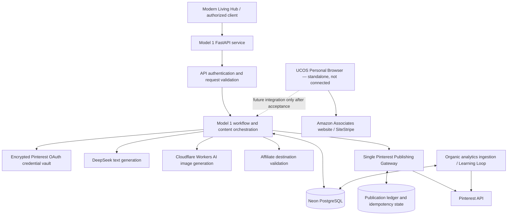

# Pinterest Affiliate Marketing Agent — Model 1.2 Architecture Freeze

**Document status:** Architecture baseline frozen (documentation change only)  
**Version:** Model 1.2  
**Date:** 2026-11-06  
**Applies to:** Pinterest Affiliate Marketing Agent, Model 1  
**Companion service:** UCOS Personal Browser (standalone; not integrated yet)

> This document freezes the intended architecture and boundaries. It is not a claim that every component is production-ready, deployed, or independently verified. Implementation status and release gates remain separate.

---

## 1. Architecture decisions

1. Model 1 remains the Home Decor & Kitchen affiliate-marketing system for the USA target market.
2. Model 1 scope remains exactly these seven capabilities:
   - Publish
   - Pin Idea
   - Description
   - Title
   - Alt Text
   - Affiliate Link
   - Learning Loop
3. UCOS Personal Browser remains a separate, independently deployed service. It is **not connected to Model 1 in this release**.
4. Personal Browser integration is permitted only after that service independently passes its production-readiness acceptance gates in Section 10.
5. Every application Pin-creation path must pass through the single Model 1 publishing gateway and durable publication ledger.
6. Tests and diagnostics must not create, publish, edit, or delete real Pinterest Pins or boards. Use mocks, stubs, and read-only production checks.
7. Pinterest Ads API scopes, including `ads:read`, advertiser discovery, and audience insights are out of Model 1 scope and deferred to Model 2.
8. No Cloudflare Images dependency or separate image-hosting service is introduced by this architecture. Cloudflare Workers AI is the image-generation provider in the current Model 1 design; generated image data is passed through the approved Pinterest media-source flow.
9. Learning Loop is descriptive analytics ingestion and reporting. Predictive ML/model training is not part of Model 1.2 and must not be represented as active.

## 2. System context

Model 1 is the decision-making and workflow layer. It accepts product inputs, generates Pin content, obtains/validates an affiliate destination, resolves an existing Pinterest board, and requests publication through its controlled gateway. It stores product/content/publication state and ingests organic Pinterest analytics.

The Modern Living Hub is an external user-facing integration/client. It may hand off an explicitly selected account, board, product/content data, or a manual publishing request through the documented authenticated Agent API. It is not a second Pinterest publishing engine and must not bypass the Agent's publication controls.

The UCOS Personal Browser is a separate browser infrastructure service. Until it is accepted as production-ready, Model 1 continues to operate without depending on it. Its future role is limited to Amazon Associates browser research and actual affiliate-link capture.

## 3. Logical architecture

The dotted Personal Browser-to-Model 1 relationship is a future target only. It is not a current network connection, deployed dependency, or completed integration.

## 4. Model 1 responsibilities and boundaries

| Capability | Model 1 responsibility | Boundary |
|---|---|---|
| Pin Idea | Produce a relevant idea from supplied/verified product context | Do not invent product facts |
| Title | Generate a concise Pin title | Validate required fields and platform limits |
| Description | Generate useful description and required affiliate disclosure where applicable | Do not make unsupported product/health claims |
| Alt Text | Generate a cautious text draft from supplied product facts and intended composition | It is not visual verification; review against the final image |
| Affiliate Link | Accept and validate the destination URL and preserve tracking parameters | Syntax validation alone does not prove Associate ownership or link provenance |
| Publish | Submit approved content/media/destination to Pinterest | Single gateway and publication ledger only |
| Learning Loop | Ingest real organic Pinterest metrics and produce descriptive summaries | No fabricated metrics and no predictive model claims |

### Current affiliate-link provenance

Until Personal Browser passes its independent acceptance gate and is later integrated, the affiliate URL is supplied through the existing Model 1/Hub input contract. Model 1 may validate URL structure and preserve the supplied URL, but must not claim that it independently logged into Amazon, generated a SiteStripe link, or verified Associate-account ownership.

After future browser integration, the adapter may return a captured affiliate URL plus minimal provenance evidence. The Agent must validate the returned data before it enters the content/publishing workflow. No credentials, cookies, or browser encryption keys are returned to Model 1.

## 5. Publishing control plane

### 5.1 Single write gateway

`app/publishing_gateway.py` is the sole application-level Pinterest Pin creation gateway. Every automated Pin-creation route must delegate to it. No route, Hub handoff, helper, browser worker, or scheduled job may call Pinterest `POST /pins` directly.

The gateway owns:
- Required Pin field and media-source validation.
- Account and board binding.
- Durable publication reservation before the provider write.
- Idempotency and duplicate prevention.
- Pinterest Pin creation request.
- Definite success/failure and uncertain-outcome recording.
- Safe response metadata.

### 5.2 Publication state invariants

- `succeeded`: return the existing publication result; never create a duplicate.
- `pending`: block another write while the prior attempt is unresolved.
- `unknown`: block automatic retry; require read-only Pinterest verification and explicit operator reconciliation.
- Definite provider rejection: record failure; retry only through the approved retry policy and a new authorized attempt.
- If Pinterest may have created a Pin but ledger persistence fails, do not retry blindly.

The publication ledger is the source of truth for the Agent's attempt history. Pinterest board/Pin verification is read-only and is used as evidence for reconciliation.

### 5.3 Board policy

The autonomous Model 1 publishing workflow resolves an existing board using read-only Pinterest requests. It must not silently create a board as a side effect of product generation or publishing. Any separately authorized board-management operation must remain distinct from Pin publishing and must not weaken gateway invariants.

### 5.4 Testing policy

CI, smoke tests, diagnostics, and integration preflight must use mocked Pinterest write responses or non-mutating read-only endpoints. No test may issue a real `POST /pins`, create a board, or perform a real Pin publication. A real production publish requires a separate explicit human authorization and is never implied by test approval.

## 6. Data, providers, and secret custody

- **Neon PostgreSQL:** product records, content versions, publication ledger, analytics snapshots, and encrypted Pinterest OAuth credentials.
- **Pinterest OAuth:** account-scoped credentials are read from the encrypted vault. Encryption keys and OAuth client secrets remain server-side in deployment secret configuration.
- **DeepSeek:** text content generation. Provider output is untrusted input and must be schema/field validated.
- **Cloudflare Workers AI:** image generation. This does not imply Cloudflare Images storage or a separate image-hosting product.
- **Pinterest API:** board reads, Pin creation through the single gateway, and organic analytics reads within granted scopes.
- **Secrets:** never commit, log, return, or expose API keys, OAuth tokens, cookies, Fernet keys, or database credentials. Do not copy secret values into chat or architecture documents.

Production token refresh must use the approved protected lifecycle. Never force production token expiry, rotate a valid credential solely for testing, or expose token material. A successful mocked refresh test is not proof of a real production token rotation.

## 7. Learning Loop

The Learning Loop:
1. Reads eligible Pins and organic analytics using granted Pinterest scopes.
2. Stores provider-returned metrics and their time window.
3. Preserves missing metrics as unknown/null rather than converting them to fabricated zeroes.
4. Produces descriptive summaries and operational signals.

It does not train a predictive model, claim causality, or autonomously change publishing strategy based on statistically insufficient data. Predictive ML remains deferred until sufficient real longitudinal data and a validated evaluation plan exist.

## 8. UCOS Personal Browser — separate service boundary

### 8.1 Current state

The Personal Browser repository contains a standalone Playwright/Chromium browser service, authenticated API, browser task controls, encrypted browser session persistence for PostgreSQL/Neon, audit metadata, tests, and GitHub Actions workflows. Its production readiness is **not yet confirmed**. A successful historical smoke run is not sufficient evidence of full production readiness.

Model 1.2 does not configure a browser URL, browser token, browser profile, browser database, or browser adapter. No Model 1 runtime call to the Personal Browser is authorized by this freeze.

### 8.2 Future, limited responsibility

After independent acceptance, a Model 1-side adapter may call the browser service over authenticated HTTPS for the following Amazon Associates tasks:
- Open the approved Amazon marketplace.
- Reuse a manually authenticated Amazon browser profile.
- Search and inspect product pages.
- Capture the actual affiliate URL exposed by Amazon SiteStripe.
- Return the URL and minimal evidence metadata to Model 1.

The browser is an execution tool, not the Agent's decision-making brain. Model 1 decides product relevance, content, validation, and whether a workflow should proceed.

### 8.3 Prohibited browser responsibilities

The Personal Browser must not:
- Create or publish Pinterest Pins.
- Access or store Model 1's Pinterest OAuth token.
- Receive Model 1's database credentials or encryption keys.
- Bypass CAPTCHA, MFA, login controls, or Amazon anti-bot protections.
- Fabricate affiliate URLs or claim an unverified short link has a confirmed destination.
- Return raw cookies, passwords, session state, or unnecessary page data to Model 1.

Browser session encryption keys remain exclusively in the browser service's secret boundary. Profile access must be isolated by authenticated caller/profile authorization.

## 9. Security and reliability invariants

- Sensitive API routes fail closed when required authentication configuration is missing.
- Browser and Agent secrets remain in their respective server-side secret stores.
- Enforce account scoping for Pinterest credentials and browser profile authorization for browser sessions.
- Validate all external inputs and provider responses.
- Apply bounded timeouts, concurrency controls, rate limits, and safe retries.
- Never automatically retry an ambiguous non-idempotent Pinterest Pin write.
- Protect browser navigation against SSRF, including redirects, DNS rebinding, and subresource requests; URL pre-validation alone is insufficient.
- Keep audit records useful but minimal. Never log credentials, cookies, raw page contents, or full sensitive request bodies.
- Production readiness requires observed deployment/runtime evidence, not only local tests or documentation.

## 10. Independent Personal Browser production-readiness gate

All critical checks below must pass before any Model 1 integration work begins:

1. **Authentication and authorization:** bearer-token enforcement, profile ownership isolation, unauthorized access rejection, and secret rotation procedure.
2. **Network security:** SSRF protection covering redirects, DNS changes/rebinding, browser subresources, private/link-local/metadata destinations, and unsafe schemes.
3. **Session durability:** encrypted state write/read, correct-key restore, wrong/missing-key fail-closed behavior, and successful session restoration after an actual service restart.
4. **Amazon workflow:** manually authenticated account session, product search/navigation, SiteStripe capture, marketplace/tag validation, and clear handling of login expiry or unavailable SiteStripe.
5. **Audit/privacy:** task audit is useful and redacted; no passwords, cookies, session state, screenshots, or raw page content leak into logs.
6. **Operational controls:** bounded concurrency, task timeout/cancellation behavior, memory/resource limits, health/readiness semantics, and graceful shutdown.
7. **Automated verification:** all repository tests and CI pass on the exact candidate commit; negative security tests pass.
8. **Deployment verification:** current Render service is confirmed live on the candidate commit; protected endpoint behavior and restart recovery are tested against the deployed service.
9. **Acceptance record:** each check has timestamped evidence, owner-visible PASS/FAIL, and no unresolved critical/high-severity blocker.

Only after these gates pass may a separate integration change be proposed. That later change must use a narrow Agent-side adapter, dedicated service-to-service authentication, strict request/response schemas, timeouts, and no credential sharing. It must not modify or bypass the publishing gateway.

## 11. Release gates for Model 1

Architecture freeze does not mark these gates complete:
- Verify all current Model 1 source and deployed commit alignment.
- Verify consistent fail-closed authentication on every sensitive route.
- Verify the production Pinterest OAuth refresh lifecycle safely when naturally due; never force expiry.
- Verify all Pin-creation paths are governed by the single gateway and ledger.
- Verify uncertain publication reconciliation without risking a duplicate real Pin; use a provider stub/test environment.
- Verify production migrations and backup/recovery procedures.
- Verify provider readiness and safe failure behavior.
- Verify Learning Loop data provenance and descriptive-only claims.
- Preserve the no-real-Pin testing rule.

A release may be called production-ready only when its applicable release gates have evidence. Passing CI alone is not production acceptance.

## 12. Change control

This document is the Model 1.2 architecture baseline. Implementation may be corrected to conform to it, but a change to a frozen boundary requires an explicit owner-approved architecture revision (for example, Model 1.3) with:
- The decision being changed and why.
- Security, data-flow, operational, and cost impact.
- Migration and rollback plan.
- Updated tests and acceptance evidence.

No implicit scope expansion is allowed. In particular, Personal Browser remains standalone until its independent acceptance is complete; Ads API capabilities remain deferred to Model 2; predictive ML remains deferred; and no test may publish a real Pinterest Pin.
